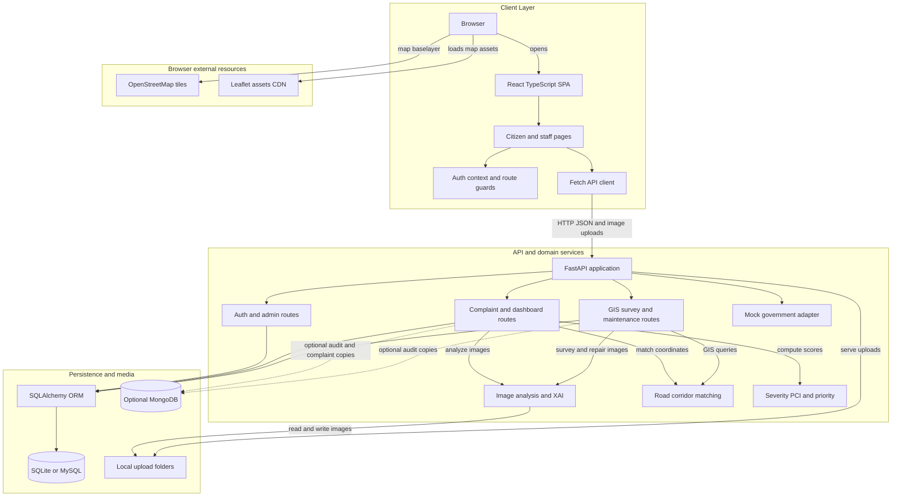
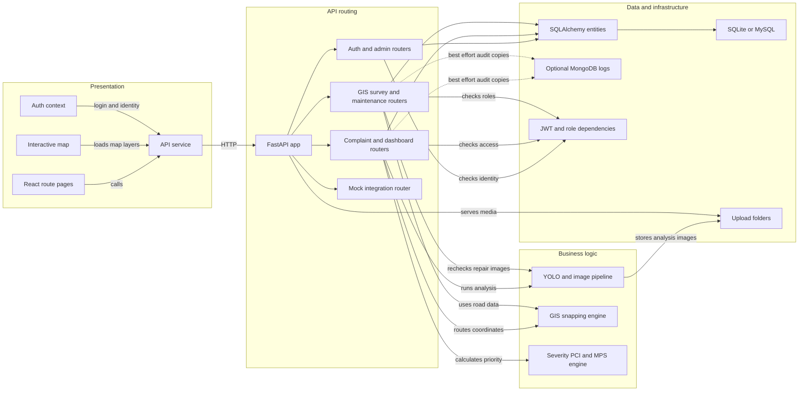

# Architecture Diagram

RoadGuard is a web application for detecting road-surface defects, routing reports to a configured road authority, prioritizing maintenance, and checking repair evidence. This view describes the active `roadguard/` application; datasets, academic submissions, and earlier prototypes are supporting project assets rather than runtime services.

## Application Architecture

<!-- mermaid-checked: no \n, no em-dash/en-dash, no {} in labels, subgraphs are id["label"], arrows are -->|"label"|, all subgraphs closed by end, ids unique -->

### Technology Stack Summary

| Layer | Technology | Version | Purpose |
|---|---|---|---|
| Web UI | React, TypeScript, React Router | React 19.2.8; TypeScript ~6.0.2; Router 7.18.4 | User portal, role-based dashboards, maps, complaint and repair workflows |
| Frontend build and styles | Vite, Tailwind CSS, Oxlint | Vite 8.3; Tailwind 4.3; Oxlint 1.81 | Development server, production bundling, styling, linting |
| Mapping | Leaflet and OpenStreetMap | Leaflet 1.9.4 | Browser map display and road/defect layers |
| API | Python, FastAPI, Pydantic | README states Python 3.12 and FastAPI 0.110; active backend has no dependency lock/manifest | REST API, validation, OpenAPI documentation |
| Relational persistence | SQLAlchemy | 2.0 as stated in project documentation | ORM models and database sessions |
| Computer vision | Ultralytics YOLO, OpenCV, NumPy, Pillow | Checkpoint is YOLOv8s-RoadSense; exact Python dependency versions are not pinned in the active backend | Detect defects, preprocess images, draw annotations, create saliency overlays |
| Authentication | bcrypt and JWT | Configured as HS256 | Password hashing, bearer tokens, role checks |
| Relational database | SQLite or MySQL | SQLite default; Compose describes MySQL 8 | Store users, roads, complaints, detections, tasks, verifications, surveys, and audit rows |
| Optional document store | MongoDB / PyMongo | Optional, not pinned in active backend | Best-effort audit and complaint document copies |

### Data Storage & External Services

The default configuration stores relational data in `backend/roadguard.db`; `DATABASE_URL` can select another supported relational database, and the Compose file describes a MySQL 8 service. Uploaded source images, annotated results, saliency overlays, and repair evidence are stored as files beneath `backend/uploads/`, with file URLs held in SQL records. MongoDB is optional and best-effort: when configured and reachable, selected audit and complaint records are copied to document collections; otherwise the application reports relational-only operation. The map uses browser-loaded Leaflet assets and OpenStreetMap tiles. Government submissions are mock/demo adapters, not live agency integrations.

### Key Architectural Decisions

- The frontend is a React SPA using a shared fetch client and a FastAPI `/api/v1` interface; the Vite development server proxies API and upload paths to the backend.
- Core business calculations are isolated into AI, GIS, and priority modules, while SQLAlchemy models persist the complaint-to-work-order lifecycle.
- GIS coverage is a small hard-coded demonstration network. A match beyond the 350 m tolerance goes to a manual-routing queue rather than selecting an authority arbitrarily.

## Component Relationships

<!-- mermaid-checked: no \n, no em-dash/en-dash, no {} in labels, subgraphs are id["label"], arrows are -->|"label"|, all subgraphs closed by end, ids unique -->

### Component Inventory

| Component | Layer | Type | Responsibility |
|---|---|---|---|
| React route pages | Presentation | Pages | Landing, login, registration, reporting, tracking, citizen, authority, inspection, maintenance, XAI, vision, and admin screens |
| Interactive map | Presentation | UI component/page | Displays road network and active defects using Leaflet |
| Auth context and route guards | Presentation | State and access control | Stores the bearer token in browser local storage and gates selected routes by role |
| API service | Presentation | HTTP client | Calls authentication, complaint, GIS, maintenance, survey, dashboard, admin, and mock integration endpoints |
| FastAPI app | API routing | Application entry point | Configures CORS, static uploads, routers, health endpoints, startup database tables, sample road segments, and demo users |
| Auth and admin routers | API routing | REST routers | Registration, login, current user, user status, logs, health, and scoring configuration |
| Complaint and dashboard routers | API routing | REST routers | Analyze and submit reports, track/list complaints, and provide dashboard statistics |
| GIS, survey, and maintenance routers | API routing | REST routers | Road lookup and snapping, inspector survey sessions, work orders, repair uploads, and closure approval |
| YOLO and image pipeline | Business logic | Computer vision service | Blur metric, CLAHE, multi-scale inference, duplicate-box suppression, severity, annotated output, heuristic fallback, and Sobel/Laplacian saliency |
| GIS snapping engine | Business logic | Geospatial service | Finds the closest of four configured corridors using sampled points and Haversine distance; flags unmatched locations |
| Severity, PCI, and MPS engine | Business logic | Scoring service | Calculates per-defect severity, an adapted PCI proxy, degradation forecast, and priority tier |
| SQLAlchemy entities | Data access | ORM models | Users, road segments, complaints, detections, tasks, verifications, survey sessions/frames, audit logs, and scoring configuration |
| Relational database | Data access | SQLite/MySQL | Primary structured application store |
| Upload folders | Infrastructure | Local file storage | Original, annotated, XAI, and repair images served from `/uploads` |
| JWT and role dependencies | Cross-cutting | Authentication/authorization | Resolves bearer tokens and enforces role checks on protected API actions |
| Optional MongoDB logs | Infrastructure | Document store | Best-effort copies of audit and complaint data when configured |
| Mock integration router | Integration | Demonstration adapter | Returns clearly labeled simulated government portal submissions and reference codes |
